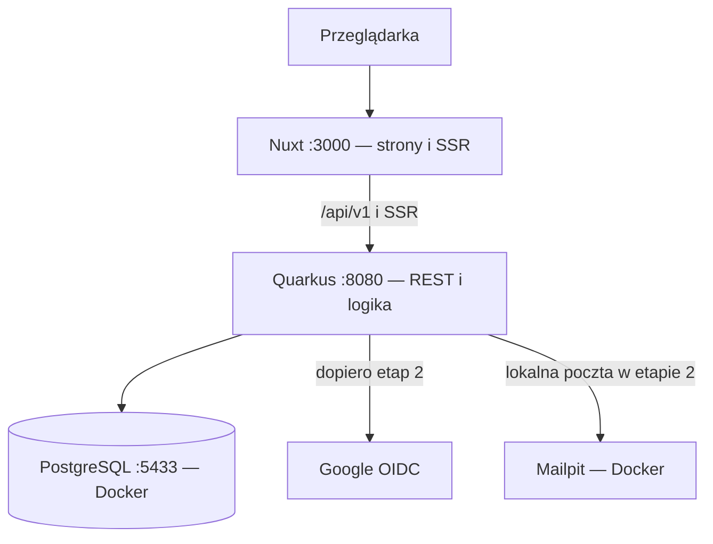

# Plan budowy platformy do wspólnych podróży

Wersja: 1.1 — 2026-11-06. Robocza nazwa: **Travel Buddy**.

Docelowe miejsce w repozytorium: `docs/PLAN.md`.

## 0. Aktualny sposób pracy i instrukcja dla Codex

**Najpierw budujemy i testujemy produkt wyłącznie lokalnie na macOS. Wdrożenie nastąpi dopiero, gdy produkt będzie użyteczny.**

- Setup narzędzi i lokalnego repozytorium został wykonany przez autora. Nie zakładaj, że istnieje już kod aplikacji — sprawdź repozytorium.
- Etapy 1, 2A i 2B są zaimplementowane lokalnie. Etap 3 (profil podróżnika i prywatne kontakty) został zaimplementowany i zweryfikowany lokalnie 2026-11-13; zakres i wyniki weryfikacji znajdują się w README. Kolejne etapy pozostają poniżej jako plan, nie jako wykonane funkcje.
- Ten dokument opisuje cały kierunek produktu. **Nie jest poleceniem implementacji całego MVP w jednym zadaniu.** Realizuj tylko etap wskazany w aktualnym poleceniu.
- Instrukcje pracy z kodem znajdują się w głównym `AGENTS.md`.
- Istotne decyzje i odstępstwa zapisuj w `docs/DECISIONS.md`, a rzeczywiste polecenia uruchamiania w `README.md`.
- PostgreSQL działa w Docker Compose. Quarkus i Nuxt działają lokalnie w trybach developerskich, z hot reload.
- Lokalne adresy: Nuxt `http://localhost:3000`, Quarkus `http://localhost:8080`, PostgreSQL `127.0.0.1:5433`.
- Przeglądarka wywołuje względne `/api/v1` przez proxy Nuxta. SSR również musi poprawnie pobierać dane z backendu.
- Na początku nie konfigurujemy VPS, domeny, Cloudflare, produkcyjnych obrazów, CI/CD ani płatnych usług.
- Google OAuth i obsługę e-maili konfigurujemy dopiero w etapie kont. E-maile w lokalnym środowisku trafiają do lokalnego odbiornika, np. Mailpit.
- Nie dodawaj automatycznych commitów, pushowania ani wdrażania. Nie kasuj danych i wolumenów bez wyraźnej zgody.
- Podane dalej koszty hostingu są historycznym szacunkiem z wcześniejszego planu, a nie zadaniem zakupowym ani gwarancją ceny.

### Co zmienia ta wersja planu

1. Odkłada publiczne wdrożenie, CI/CD i usługi produkcyjne do osobnego etapu po lokalnym MVP.
2. Ustala lokalny toolchain: Java 21, Node 24, PostgreSQL 17, npm i Maven Wrapper.
3. Zachowuje pełny zakres produktu oraz zasady prywatności i uprawnień.
4. Doprecyzowuje pierwszy etap: schemat demonstracyjny jest minimalny, a kolejne moduły i migracje powstają stopniowo.
5. Dokument jest specyfikacją do realizacji, nie potwierdzeniem, że opisane funkcje już istnieją.

## 1. Produkt, decyzje techniczne i koszty

### 1.1. Cel

Platforma, na której ludzie publikują ustrukturyzowane plany podróży i szukają kompanów do wspólnego wyjazdu. Przewaga nad chaotycznymi grupami społecznościowymi: porządne ogłoszenia, filtry, indeksowane strony, bezpieczeństwo i kontrola udostępniania kontaktów.

Projekt hobbystyczny jednej osoby znającej Java/Quarkus, JavaScript/Vue i SQL. Celem jest szybko działający produkt, następnie walidacja zainteresowania i ewentualna monetyzacja.

### 1.2. Zakres MVP 1.0

1. Rejestracja i logowanie: e-mail + hasło oraz Google OIDC. Bez obowiązkowego potwierdzenia e-maila; przygotowanie do dodania później. Odzyskiwanie hasła jako niezbędne domknięcie lokalnego logowania.
2. Profil: pseudonim/imię, deklarowany wiek, języki, style podróżowania, bio oraz prywatne kontakty: Instagram, WhatsApp, e-mail.
3. Wyprawy: tworzenie draftu, publikacja, edycja, zamknięcie; kraje/miasta, opis planu, daty dokładne/elastyczne, docelowa liczba osób, kogo szukam, budżet, style i język treści.
4. Publiczna lista i szczegóły z filtrami kraju, terminu, budżetu i stylu; SSR, meta tagi, sitemap i czytelne URL-e.
5. Zgłoszenie „Chcę dołączyć” z jedną wiadomością do organizatora.
6. Akceptacja/odrzucenie, wycofanie zgłoszenia, publiczna minimalna lista uczestników. Kontakty dopiero po akceptacji.
7. Zgłaszanie nadużyć oraz prosty panel admina: ukrywanie ogłoszeń, blokowanie kont, uzasadnienia i audyt.
8. Interfejs PL/EN od początku. Treść autora bez automatycznego tłumaczenia.
9. Usunięcie konta i danych, retencja, regulamin, polityka prywatności, obsługa preferencji cookies przygotowana do przyszłych reklam.

Poza MVP: zdjęcia, uploady, mapy, WYSIWYG, plan dnia, czat, opinie, weryfikacja dokumentów, zapisane filtry, powiadomienia o dopasowaniach, rozliczanie kosztów, Facebook, płatności i aplikacja natywna.

### 1.3. Założenia produktowe do zatwierdzenia

- Użytkownicy 18+, wiek deklarowany; bez weryfikacji dokumentów.
- Wyjazdy prywatne. Płatne oferty komercyjnych organizatorów poza MVP.
- Organizator jest uczestnikiem. `target_people` obejmuje organizatora.
- Kontakty po akceptacji widoczne w obu kierunkach **organizator ↔ zaakceptowany uczestnik**. Pozostali uczestnicy nie otrzymują automatycznie kontaktów do siebie.
- Publiczne uczestnictwo jest jasno komunikowane przed zgłoszeniem.
- Budżet oznacza orientacyjny koszt całego wyjazdu na osobę; w MVP waluta PLN.
- Plan to zwykły tekst i uporządkowane lokalizacje, bez szczegółowego harmonogramu dnia.
- Brak ponownego zgłaszania po odrzuceniu lub wycofaniu w MVP.
- Po pierwszej akceptacji nie można zmienić krajów, dat ani budżetu. Można edytować opis i zwiększyć liczbę miejsc.

### 1.4. Stack

| Obszar | Decyzja | Powód |
| --- | --- | --- |
| Backend | Java 21, stabilny Quarkus 3.x | Znany autorowi stack |
| Build | Maven Wrapper | Powtarzalna wersja narzędzia |
| API | REST JSON, Bean Validation, OpenAPI | Prosty kontrakt i walidacja |
| Dane | PostgreSQL 17, Hibernate ORM/Panache, Flyway | Relacje, transakcje i kontrolowane migracje |
| Frontend | Nuxt 4, Vue, TypeScript | SSR i znany framework |
| Pakiety JS | npm, commitowany `package-lock.json` | Jeden menedżer zależności |
| Języki | `@nuxtjs/i18n`, PL/EN | Wielojęzyczność od początku |
| Auth | Hasło + Google OIDC, wspólna sesja aplikacji w PostgreSQL | Kontrola sesji i natychmiastowa blokada |
| Testy | JUnit, Testcontainers, Playwright | Testy realnej bazy i krytycznych ścieżek |
| Repozytorium | Monorepo | Prostsza praca z AI i spójny kontrakt |
| Development | PostgreSQL w Compose, aplikacje lokalnie | Łatwiejszy debugging i hot reload |
| Późniejsza produkcja | Jeden VPS, Docker Compose i Caddy | Niski koszt i mało infrastruktury |

Wybieraj konkretne stabilne wersje kompatybilne ze wskazanymi głównymi wersjami. Bez snapshotów, `nightly` i niekontrolowanych aktualizacji głównych wersji.

Moduły backendu: `identity`, `profiles`, `trips`, `applications`, `moderation`. Jeden modularny monolit, jedna baza. Bez mikroserwisów, Redisa, Kafki, Kubernetes i osobnego serwera IAM.

### 1.5. Architektura lokalna



- Nuxt nie łączy się z bazą i nie decyduje o uprawnieniach.
- Cała logika dostępu jest w Quarkusie.
- SSR publicznych stron pobiera wyłącznie publiczne DTO, bez cookies użytkownika.
- Prywatne widoki konta mogą być CSR; prywatne odpowiedzi nie są cache'owane.
- PostgreSQL w Compose ma nazwany wolumen i healthcheck. Nie wymuszaj `amd64` na Apple Silicon.
- Nie uruchamiaj drugiej bazy przez Dev Services w lokalnym profilu korzystającym z Compose. Testcontainers może uruchamiać osobną bazę testową.

### 1.6. Prostsze warianty

**Rekomendacja: pozostań przy Quarkus + Nuxt.** Zysk ze znanych narzędzi przewyższa redukcję liczby procesów.

- Quarkus + Qute: mniej infrastruktury frontendu; alternatywa, jeśli zaakceptujesz strony oparte głównie na formularzach i przeładowaniach.
- Sam Nuxt/Nitro + PostgreSQL: mniej komponentów, ale nowy ORM i podejście do auth w TypeScript mogą spowolnić pracę.
- **[CZAS]** Dwa runtime'y i SSR zwiększają konfigurację. Nie buduj dodatkowego BFF z logiką domenową ani osobnej warstwy usług.
- **[CZAS]** Łączenie auth lokalnego i OIDC jest trudne. Użyj `quarkus-oidc` do protokołu; nie implementuj ręcznie walidacji OIDC.

### 1.7. Budżet — dopiero przed wdrożeniem

Lokalnie nie ma kosztu hostingu. Narzędzia wybrane do developmentu mają warianty bezpłatne dla tego zastosowania; Codex podlega dostępowi i limitom konta autora.

Poniższe kwoty pochodzą z wcześniejszego sprawdzenia 2026-11-05. Przed zakupem sprawdź aktualny cennik, dostępność i podatki. Przeliczenie robocze: 4,30 PLN/EUR i 23% VAT, nie aktualny kurs walutowy.

| Element | Szacunek miesięczny | Alternatywa |
| --- | --- | --- |
| Hetzner CX23, 4 GB RAM | 5,49 EUR netto, ok. 29,04 zł brutto | Development lokalny za 0 zł; brak gwarantowanego darmowego odpowiednika produkcyjnego |
| IPv4 | 0,50 EUR netto, ok. 2,65 zł brutto | IPv6 bez dopłaty, lecz wymaga sprawdzenia dostępności administracji i integracji |
| Domena .pl | Odnowienie 72,56 zł/rok, ok. 6,05 zł/mies. | Darmowa subdomena do testów |
| Cloudflare Free, Caddy, certyfikat | 0 zł | DNS rejestratora i Caddy |
| Poczta transakcyjna | 0 zł w darmowym limicie, np. Resend | Istniejący SMTP dopuszczający takie użycie; lokalnie Mailpit |
| Backup B2 | 0 zł do 10 GB storage, z uwzględnieniem limitów operacji/transferu | Szyfrowana kopia na własnym urządzeniu poza VPS |
| CI i podstawowy monitoring | 0 zł w darmowych limitach | Lokalny build, skrypty i ręczne wdrożenie |

Suma robocza: **ok. 37,74 zł/mies.** CX23 był oznaczony jako niedostępny; dostępność jest ryzykiem. CX33 za 8,49 EUR netto daje wraz z IPv4 i domeną ok. **53,60 zł/mies.**

Resend w sprawdzonym cenniku: 3000 wiadomości/mies. i 100/dzień. Nie zakładaj płatnego rozszerzenia bez osobnej decyzji. Darmowy limit storage nie oznacza braku wszystkich możliwych kosztów usługi.

## 2. Docelowy model danych

Model poniżej jest modelem docelowym MVP. **W etapie 1 implementuj wyłącznie minimalny model demonstracyjnej wyprawy.** Rozszerzaj schemat migracjami w kolejnych etapach.

### 2.1. Konwencje

- PK: UUID generowane w aplikacji.
- Zdarzenia: `timestamptz`, UTC; daty podróży: `date`.
- Kwoty: `numeric(10,2)`; nigdy `float`.
- Statusy: `varchar` + `CHECK`, zamiast PostgreSQL ENUM.
- `?` oznacza nullable. Pozostałe pola wymagane, chyba że jawnie dotyczą niekompletnego draftu.
- Tabele biznesowe: `created_at`; zmienialne rekordy: także `updated_at`.
- FK mają indeks, o ile odpowiedni indeks nie zaczyna się już od tej kolumny.
- Encje ORM nigdy nie są bezpośrednią odpowiedzią API.
- `version integer` w profilu i wyprawie służy do optimistic locking.
- Granice długości treści i słowniki walidowane w API; istotne ograniczenia również w bazie.

### 2.2. Konta i profile

| Tabela | Kolumny | Ograniczenia i indeksy |
| --- | --- | --- |
| `users` | `id uuid`, `email varchar(254)`, `email_verified_at timestamptz?`, `password_hash text?`, `role varchar(16)` USER/ADMIN, `status varchar(24)` ACTIVE/BLOCKED/DELETION_PENDING, `ui_locale varchar(5)` pl/en, `terms_version varchar(32)`, `terms_accepted_at timestamptz`, `deletion_requested_at timestamptz?`, znaczniki czasu | UNIQUE `lower(email)`; indeks `(status, deletion_requested_at)` |
| `auth_identities` | `id uuid`, `user_id uuid → users`, `provider varchar(32)`, `issuer varchar(255)`, `subject varchar(255)`, `created_at` | UNIQUE `(issuer, subject)` i `(user_id, provider)` |
| `sessions` | `id uuid`, `user_id uuid → users`, `token_hash bytea`, `created_at`, `expires_at`, `last_seen_at`, `authenticated_at` | UNIQUE `token_hash`; indeksy `user_id`, `expires_at` |
| `auth_tokens` | `id uuid`, `user_id uuid → users`, `purpose varchar(24)` PASSWORD_RESET/EMAIL_VERIFY, `token_hash bytea`, `expires_at`, `consumed_at?` | UNIQUE `token_hash`; indeks `expires_at` |
| `traveler_profiles` | `user_id uuid PK/FK → users`, `display_name varchar(60)`, `age smallint`, `age_updated_at date`, `bio varchar(1000)`, `languages text[]`, `travel_styles text[]`, `version integer`, znaczniki czasu | CHECK wieku 18–120; walidacja kodów języków i stylów |
| `profile_contacts` | `user_id uuid PK/FK → users`, `contact_email varchar(254)?`, `instagram_handle varchar(30)?`, `whatsapp_e164 varchar(16)?`, `updated_at` | Bez wyszukiwania użytkowników po kontaktach |

Profil może nie istnieć przed pierwszym wypełnieniem formularza. Do publikacji lub zgłoszenia wymagany jest kompletny profil i przynajmniej jeden kontakt.

Wiek jest deklarowany, z datą aktualizacji; bez dokładnej daty urodzenia. Po roku pokaż przypomnienie o aktualizacji.

**E-mail logowania nie jest automatycznie kontaktem publicznym ani kontaktem udostępnianym uczestnikom.** Są to osobne pola.

### 2.3. Wyprawy i zgłoszenia

| Tabela | Kolumny | Ograniczenia i indeksy |
| --- | --- | --- |
| `trips` | `id uuid`, `organizer_id uuid → users`, `title varchar(120)?`, `slug varchar(160)?`, `content_language varchar(35)?`, `itinerary text?`, `looking_for varchar(2000)?`, `date_mode varchar(16)?` EXACT/FLEXIBLE, `date_from date?`, `date_to date?`, `duration_days smallint?`, `target_people smallint?`, `budget_min numeric(10,2)?`, `budget_max numeric(10,2)?`, `currency char(3)` PLN, `styles text[]`, `status varchar(16)` DRAFT/OPEN/CLOSED, `moderation_status varchar(16)` VISIBLE/HIDDEN, `published_at timestamptz?`, `closed_at timestamptz?`, `version integer`, znaczniki czasu | FK organizatora; CHECK zakresów; dodatkowe indeksy listy poniżej |
| `trip_locations` | `id uuid`, `trip_id uuid → trips`, `position smallint`, `country_code char(2)`, `city varchar(120)?` | UNIQUE `(trip_id, position)`; indeks `(country_code, trip_id)` |
| `applications` | `id uuid`, `trip_id uuid → trips`, `applicant_id uuid → users`, `message varchar(2000)`, `status varchar(16)` PENDING/ACCEPTED/REJECTED/WITHDRAWN, `decided_at timestamptz?`, znaczniki czasu | UNIQUE `(trip_id, applicant_id)`; indeksy `(trip_id, status, created_at)`, `(applicant_id, created_at DESC)` |

Nullable pola treści pozwalają zapisać niekompletny draft. Serwis publikacji sprawdza kompletność, a ograniczenia bazy w miarę możliwości wymuszają ją dla OPEN/CLOSED. `itinerary` ma limit aplikacyjny, np. 10 000 znaków.

Nie twórz osobnej tabeli uczestników. Uczestnicy to organizator i użytkownicy ze zgłoszeniem ACCEPTED. Publiczny widok wyklucza konta zablokowane/usuwane.

**Daty:**

- EXACT: `date_from` i `date_to` to faktyczny początek i koniec.
- FLEXIBLE: najwcześniejszy możliwy początek i najpóźniejszy koniec; `duration_days` to planowana długość.
- Filtr dat sprawdza nachodzenie przedziałów. Dla FLEXIBLE UI informuje, że dopasowanie jest orientacyjne.
- CHECK `date_from <= date_to`.
- Dla FLEXIBLE długość jest dodatnia i mieści się w oknie, liczonym w dniach kalendarzowych z oboma końcami.
- `target_people` od 2 do 50, obejmuje organizatora.
- `0 <= budget_min <= budget_max`, waluta PLN.
- Publikacja wymaga co najmniej jednej lokalizacji i stylu oraz kompletnego profilu i kontaktu organizatora.
- Język treści jest niezależny od języka UI; np. `pl`, `en`, `de`.

**Indeksy listy, dodawane wraz z filtrowaniem:**

```sql
CREATE INDEX trips_public_recent_idx
ON trips (published_at DESC, id)
WHERE status = 'OPEN' AND moderation_status = 'VISIBLE';

CREATE INDEX trips_public_dates_idx
ON trips (date_from, date_to)
WHERE status = 'OPEN' AND moderation_status = 'VISIBLE';

CREATE INDEX trips_public_budget_idx
ON trips (budget_min)
WHERE status = 'OPEN' AND moderation_status = 'VISIBLE';

CREATE INDEX trips_styles_idx ON trips USING gin (styles);
```

Zapytania publiczne dodatkowo wykluczają nieaktywnego organizatora. Filtr budżetu sprawdza przecięcie przedziałów:

```sql
budget_min <= :requested_max AND budget_max >= :requested_min
```

Nie dodawaj Elasticsearch ani innych indeksów bez pomiaru `EXPLAIN ANALYZE`.

### 2.4. Moderacja i kasowanie

| Tabela | Kolumny | Ograniczenia i indeksy |
| --- | --- | --- |
| `reports` | `id uuid`, `reporter_id uuid → users?`, `reporter_name varchar(120)?`, `reporter_email varchar(254)?`, `target_trip_id uuid → trips?`, `target_user_id uuid → users?`, `target_url text`, `category varchar(32)`, `description varchar(4000)`, `good_faith boolean`, `status varchar(16)` OPEN/RESOLVED/DISMISSED, `resolved_by uuid → users?`, `resolved_at timestamptz?`, `resolution_reason text?`, znaczniki czasu | Przy utworzeniu dokładnie jeden cel, sprawdzany w serwisie; indeks `(status, created_at)` |
| `moderation_actions` | `id uuid`, `admin_id uuid → users?`, `target_trip_id uuid → trips?`, `target_user_id uuid → users?`, `action varchar(32)`, `reason text`, `created_at` | Indeksy celów i daty; zapis wyłącznie przez serwis moderacji |
| `deletion_jobs` | `id uuid`, `user_id uuid → users?`, `status varchar(16)` PENDING/RUNNING/DONE/FAILED, `requested_at`, `completed_at?`, `error_code varchar(64)?` | Indeks `(status, requested_at)` |

FK zgłoszeń/audytu do usuwanych obiektów używają `SET NULL`; tekst zgłoszeń podlega minimalizacji i retencji. Nie stosuj CHECK wymagającego zawsze istniejącego celu, jeśli później FK ma przejść na NULL. W chwili utworzenia sprawdź cel w transakcji.

Zależne dane użytkownika (sesje, kontakty, profil, tożsamości, tokeny) można usuwać kaskadowo. Wyprawy i zgłoszenia usuwaj kontrolowaną operacją serwisu; proces musi być ponawialny.

### 2.5. Transakcje i stany

Akceptacja:

1. `SELECT ... FOR UPDATE` rekordu wyprawy.
2. Sprawdzenie organizatora, OPEN, VISIBLE, aktywności kont i statusu PENDING.
3. Liczba ACCEPTED + 1 dla organizatora.
4. Jeśli brak miejsc: `409 TRIP_FULL`.
5. Zmiana zgłoszenia w tej samej transakcji.

Zmiana limitu miejsc używa tej samej blokady i nie może zejść poniżej liczby uczestników. Akceptacja nie zamyka automatycznie ogłoszenia; pełna wyprawa ma oznaczenie i nie przyjmuje nowych zgłoszeń.

- Organizator nie zgłasza się do własnej wyprawy.
- UNIQUE blokuje duplikat zgłoszenia.
- Odrzucenie dotyczy tylko PENDING.
- Wycofanie: PENDING lub ACCEPTED → WITHDRAWN; natychmiast odbiera kontakt i zwalnia miejsce.
- Zamknięcie: blokuje nowe zgłoszenia/akceptacje, odrzuca PENDING, zachowuje ACCEPTED i dostęp do kontaktów.
- Ukrycie wyprawy lub blokada któregokolwiek z kont odbierają kontakt.
- Ukrycie i stan OPEN/CLOSED są niezależne; przywrócenie nie otwiera zamkniętej wyprawy.
- Po pierwszej akceptacji istotne warunki są zablokowane. `decided_at` pozostaje także po wycofaniu, aby nie utracić informacji o wcześniejszej akceptacji.

## 3. Zarys REST API i uprawnienia

Prefiks `/api/v1`. Globalne role USER/ADMIN. **Organizator jest właścicielem konkretnej wyprawy, nie globalną rolą.**

| Metoda i endpoint | Dostęp / działanie |
| --- | --- |
| `POST /auth/register` | Publiczny; konto lokalne, regulamin, sesja |
| `POST /auth/login` | Publiczny; hasło |
| `POST /auth/logout` | Zalogowany; unieważnienie sesji |
| `GET /auth/google/start` | Publiczny; początek OIDC |
| `GET /auth/google/callback` | Zweryfikowany callback OIDC |
| `POST /auth/password-reset/request` | Publiczny; neutralna odpowiedź |
| `POST /auth/password-reset/confirm` | Jednorazowy token i nowe hasło |
| `GET /auth/session` | Użytkownik, rola, kompletność profilu; bez kontaktów |
| `GET /me` | Własny pełny profil |
| `PATCH /me/profile` | Własna edycja |
| `PUT /me/contacts` | Własne kontakty |
| `DELETE /me` | Świeże uwierzytelnienie; rozpoczęcie kasowania |
| `GET /profiles/{id}` | Minimalny profil publiczny |
| `GET /trips` | Publiczna lista |
| `GET /trips/{id}` | Publiczna widoczna opublikowana wyprawa |
| `POST /trips` | Zalogowany; draft |
| `GET /me/trips` | Własne wyprawy, także drafty i ukryte |
| `GET /me/trips/{id}` | Własny model edycyjny |
| `PATCH /trips/{id}` | Organizator, zgodność wersji |
| `POST /trips/{id}/publish` | Organizator, DRAFT → OPEN |
| `POST /trips/{id}/close` | Organizator, OPEN → CLOSED |
| `GET /trips/{id}/participants` | Publiczna minimalna lista uczestników |
| `POST /trips/{id}/applications` | Aktywny użytkownik z profilem i kontaktem |
| `GET /me/applications` | Własne zgłoszenia |
| `GET /trips/{id}/applications` | Organizator danej wyprawy |
| `POST /applications/{id}/accept` | Organizator danej wyprawy |
| `POST /applications/{id}/reject` | Organizator; PENDING |
| `POST /applications/{id}/withdraw` | Autor zgłoszenia |
| `GET /trips/{id}/contacts/{userId}` | Wyłącznie uprawniona para organizator–ACCEPTED |
| `POST /reports` | Także bez konta; ochrona antyspamowa |
| `GET /admin/reports` | ADMIN |
| `POST /admin/reports/{id}/resolve` | ADMIN; decyzja i powód |
| `POST /admin/trips/{id}/hide` i `/unhide` | ADMIN; powód |
| `POST /admin/users/{id}/block` i `/unblock` | ADMIN; powód |

Kontrakt:

- Filtry `country`, `from`, `to`, `budgetMin`, `budgetMax`, `style`, `page`, `size`.
- Domyślnie 20, maksymalnie 50 wyników; sortowanie `published_at DESC, id DESC`.
- Błędy `application/problem+json`: stabilny `code`, błędy pól, `requestId`.
- `401` brak sesji, `403` brak uprawnień, `404` brak lub niepubliczny zasób, `409` konflikt stanu/wersji.
- Publiczny profil i uczestnicy nigdy nie zawierają kontaktów ani e-maila konta.
- ADMIN nie otrzymuje automatycznie kontaktów przez zwykły endpoint.
- OpenAPI rozwijane razem z API. Generowanie typów TS dodaj, gdy zacznie ograniczać realne rozjazdy; nie blokuje pierwszego ekranu.

## 4. SEO, i18n, bezpieczeństwo i prywatność

### 4.1. SEO i i18n

1. Publiczne strony renderowane przez SSR, z treścią widoczną w HTML bez wykonania JS.
2. URL-e: `/pl/wyprawy`, `/en/trips`, `/pl/wyprawy/{uuid}/{slug}`. UUID identyfikuje rekord; stary slug → 301.
3. Tytuł, description, canonical i Open Graph dla każdej wyprawy.
4. Sitemap tylko dla publicznych kanonicznych adresów; `lastmod` od zmiany treści.
5. Lista bez filtrów indeksowalna. Kombinacje filtrów: `noindex,follow`, poza sitemap; nie generuj nieograniczonej sieci kombinacji.
6. Nie blokuj w robots.txt pobrania stron, na których robot ma odczytać `noindex`.
7. Jedna indeksowana wersja ogłoszenia, preferencyjnie zgodna z językiem treści. Drugi wariant UI ma ten sam canonical.
8. Nie oznaczaj nieprzetłumaczonej treści jako pełnego tłumaczenia przez `hreflang`. PL/EN `hreflang` dla faktycznie zlokalizowanych list i stron informacyjnych.
9. Profile `noindex`; bez osobnej wyszukiwarki ludzi.
10. Draft/ukryte publicznie 404. Usunięte może zwracać 410, jeżeli zachowujesz minimalną informację o usuniętym URL.
11. Zamknięte: 200 z wyraźnym statusem, do zakończenia retencji.
12. Teksty UI, błędy, daty, liczby i e-maile przez tłumaczenia; treść autora bez tłumaczenia automatycznego.
13. `lang` fragmentu ogłoszenia zgodny z jego treścią.
14. Nie dodawaj danych strukturalnych niezgodnych z rzeczywistym typem treści tylko dla rich results.

### 4.2. Auth i sesje

- Argon2id z utrzymywanej biblioteki, parametry skalibrowane na docelowym środowisku.
- Hasło minimum 12 znaków, obsługa długich fraz, bez arbitralnego wymuszania symboli.
- Produkcyjne cookie `__Host-session`, Secure, HttpOnly, SameSite=Lax, Path=/.
- Lokalny HTTP ma odrębną konfigurację cookie bez prefiksu `__Host-` i bez Secure; wyjątek wyłącznie w profilu dev, nigdy w produkcji.
- Losowy token sesji co najmniej 256 bitów; w bazie wyłącznie hash. Przykładowa ważność 7 dni.
- Reset hasła i blokada konta unieważniają wszystkie sesje.
- Świeże uwierzytelnienie przed kasowaniem konta: ponowne hasło lub ponowny przepływ Google.
- CSRF: token i weryfikacja Origin dla zmian stanu. OIDC callback chroniony mechanizmami protokołu.
- Brak tokenów auth w localStorage. Brak CORS `*`; przeglądarka korzysta z jednego origin.
- OIDC przez utrzymywaną bibliotekę: podpis, issuer, audience, exp, state, nonce; PKCE zgodnie z obsługą integracji.
- Tożsamość Google po `issuer + sub`, nie po e-mailu.
- Bez automatycznego łączenia istniejącego konta lokalnego i Google po zgodnym e-mailu. Pokaż drogę logowania lokalnego/odzyskania hasła. Jawne łączenie później.
- `email_verified_at` istnieje, ale nie blokuje lokalnych kont w MVP. Brak weryfikacji nie daje prawa do automatycznego łączenia kont.
- Hasła i tokeny nigdy nie trafiają do logów.

### 4.3. Kontakty

- Osobna tabela, DTO i endpoint.
- Kontrola uprawnionej relacji przy każdym pobraniu.
- Prywatne odpowiedzi: `Cache-Control: private, no-store`.
- Brak kontaktów w HTML, SSR payload, sitemap, JSON-LD i logach.
- UI przed zgłoszeniem i akceptacją jasno opisuje ujawnienie kontaktów.
- Odebranie dostępu w aplikacji nie usuwa skopiowanych przez odbiorcę danych; nie obiecuj takiej możliwości.
- Ostrzeżenie i podstawowe wykrywanie kontaktów w publicznych opisach; nie traktuj regexów jako gwarancji ochrony.

### 4.4. Antyspam i walidacja

| Operacja | Początkowa konfiguracja |
| --- | --- |
| Logowanie | 10 prób/15 min/IP + opóźnienia per konto; bez trwałej blokady przez napastnika |
| Rejestracja | 5/h/IP; przed publikacją Turnstile |
| Reset hasła | 3/h/adres i 10/h/IP; neutralna odpowiedź |
| Publikowanie | 3/dzień/konto, maks. 5 otwartych |
| Zgłoszenia do wypraw | 20/dzień/konto; unikalność na wyprawę |
| Raporty nadużyć | 5/h/IP; Turnstile dla anonimowych przed publikacją |
| Treści | Plain text, limity, bez HTML i uploadów |

Limity konfigurowalne. Lokalnie integracja antybot może korzystać z oficjalnych kluczy testowych; testowy tryb nie może przejść do produkcji.

- Parametryzowane SQL i whitelista sortowania.
- CSP, frame-ancestors, nosniff i ograniczone Referrer-Policy; konfiguracja dev uwzględnia HMR.
- Prawdziwy IP tylko z zaufanego proxy; lokalnie nie ufaj dowolnym nagłówkom klienta.
- Rate limiting w aplikacji, bez założenia płatnych funkcji Cloudflare.
- Uzasadnienie i audyt każdej decyzji moderacyjnej.
- Blokada konta natychmiast unieważnia sesje i odbiera kontakty; publiczne treści zablokowanego autora są niewidoczne.

### 4.5. RODO, cookies, regulamin i DSA

Poniższe to lista wdrożeniowa. Dokumenty muszą odpowiadać faktycznemu przetwarzaniu; nie jest to gotowa opinia prawna.

- Ustal administratora i kontakt.
- Opisz cele, podstawy prawne, odbiorców, retencję i prawa.
- Obsługa konta/zgłoszeń: właściwa podstawa umowna; moderacja/bezpieczeństwo: ocena uzasadnionego interesu. Bez zbiorczej „zgody na RODO”.
- Sprawdź role dostawców, umowy powierzenia i transfery poza EOG.
- Dostęp, sprostowanie, usunięcie. Eksport może być obsługiwany ręcznie po weryfikacji osoby, bez osobnego modułu UI.
- Procedura incydentu z oceną obowiązku zgłoszenia naruszenia i terminu 72 h, jeżeli zgłoszenie jest wymagane.
- Zgłaszanie nielegalnych treści także bez konta: URL, uzasadnienie i właściwe dane zgłaszającego; potwierdzenie i uzasadnienie decyzji. Mikroprojekt nie jest automatycznie zwolniony ze wszystkich obowiązków DSA.
- Regulamin: rola platformy, zasady treści i moderacji, brak gwarancji tożsamości/bezpieczeństwa wyjazdu, kanał kontaktu.
- Przed publicznym startem sprawdź aktualność obowiązków prawnych dla konkretnego modelu działalności.

Cookies:

- MVP uruchamia tylko niezbędne mechanizmy, bez marketingowej analityki i reklam.
- Przygotuj PL/EN komponent preferencji: akceptacja opcjonalnych, odrzucenie, ustawienia, późniejsze wycofanie.
- Jeżeli nie ma opcjonalnych technologii, nie wymuszaj pozornej zgody. Informacja i ustawienia wystarczają do opisu aktualnego stanu.
- Późniejsze skrypty opcjonalne blokuj do właściwej zgody; odrzucenie i cofnięcie muszą działać.
- „Reklama kontekstowa” nie gwarantuje braku śledzenia.

**[CZAS/KOSZT]** Przegląd prawny wymaga indywidualnej wyceny. Bezpłatna alternatywa: własne dokumenty oparte na źródłach urzędowych, z pozostawieniem ryzyka interpretacyjnego. Nie uznawaj wygenerowanego regulaminu za automatyczne potwierdzenie zgodności.

### 4.6. Retencja i usuwanie

| Dane | Propozycja do zatwierdzenia |
| --- | --- |
| Sesje/tokeny | Kasowanie po wygaśnięciu, codziennie |
| Logi operacyjne | 14 dni, bez kontaktów i treści wiadomości |
| Zamknięte wyprawy/zgłoszenia | Do 12 miesięcy po końcu wyjazdu; przeterminowane OPEN automatycznie zamykane |
| Moderacja i audyt | 12 miesięcy od decyzji; dłużej tylko z udokumentowanym powodem |
| Backupy produkcyjne | 7 dziennych + 4 tygodniowe, maks. ok. 35 dni |
| Żądanie usunięcia | Natychmiastowe wyłączenie konta; fizyczne kasowanie operacyjne do 7 dni |

Usunięcie obejmuje profil, kontakty, sesje, tożsamości, tokeny, zgłoszenia i własne wyprawy z zależnymi danymi. Minimalne dowody nadużyć mogą pozostać tylko na odrębnej podstawie, z retencją i ograniczonym dostępem. Soft delete sam w sobie nie zamyka procesu.

## 5. Plan etapów i gotowe polecenia dla Codex

### 5.1. Organizacja czasu

Szacunki są orientacyjne, dla jednej osoby znającej stack, pracującej z AI. Etapy 1–7: ok. **84 h**, etap późniejszego wdrożenia: **10 h**. Rezerwa na integrację i poprawki: **20 h**. Całość ok. **114 h**.

Przy 18–20 h tygodniowo to ok. 6 tygodni; przy 10 h — ok. 10–12 tygodni. Pierwsza demonstracja ma powstać po etapie 1. Wdrożenie nie jest wymagane do ukończenia etapów lokalnych.

Wspólna zasada dla każdego promptu:

> Przeczytaj AGENTS.md, docs/PLAN.md i istniejący docs/DECISIONS.md. Wykonaj wyłącznie wskazany etap. Najpierw sprawdź stan repozytorium. Nie dodawaj funkcji z kolejnych etapów. Dodaj właściwe migracje i testy zachowań. Uruchom sprawdzenia; nie deklaruj testów, których nie wykonałeś. Zaktualizuj README i decyzje. Zakończ listą zmian, wynikami testów, instrukcją ręcznej weryfikacji i ograniczeniami. Bez automatycznego commita, pushowania lub wdrożenia.

### Etap 1 — lokalny pionowy szkielet

**Czas: 8 h. Cel:** baza → API → SSR listy i szczegółów.

Zadania:

- `backend/`, `frontend/`, główny `compose.yaml`, README.
- Minimalny model demonstracyjnej wyprawy: UUID, tytuł, kraj, opis, daty, język. Pełny model i relacje później.
- Flyway, schemat walidowany przez ORM; deterministyczny seed tylko dev/test.
- GET listy i szczegółów, jawne DTO, 404.
- Nuxt SSR, PL/EN, prosta mobilna nawigacja.
- Compose wyłącznie PostgreSQL 17, port `127.0.0.1:5433`, nazwany wolumen i healthcheck.
- Aplikacje lokalnie, hot reload; proxy do `/api/v1`.
- Test API na PostgreSQL, typecheck/build frontendu i sprawdzenie treści HTML z SSR.
- Nie zakładaj, że Quarkus automatycznie czyta `.env` z katalogu głównego repozytorium. Jawnie ustaw źródło konfiguracji.

DoD: świeży checkout daje się uruchomić według README; strona zawiera prawdziwe dane z bazy i tytuł w HTML; szczegóły i PL/EN działają; dane przeżywają restart bazy. Brak logowania, CI/CD i produkcyjnych Dockerfile.

Ryzyko: rozbudowa architektury lub wyglądu. Użyj jednego prostego layoutu, bez bibliotek UI wymagających dużej konfiguracji.

Prompt:

```text
Zrealizuj etap 1 zgodnie z docs/PLAN.md: lokalny pionowy szkielet
Quarkus–PostgreSQL–Nuxt. Sprawdź Java 21, Maven, Node 24, npm i Docker.
Utwórz backend z Maven Wrapper, Flyway, REST JSON, ORM i healthcheck.
Dodaj minimalne wyprawy demonstracyjne w dev/test, listę i szczegóły.
Uruchamiaj PostgreSQL 17 przez Compose na 127.0.0.1:5433 z trwałym
wolumenem. Nie uruchamiaj dodatkowej bazy Dev Services w profilu dev.
Frontend: Nuxt 4, TypeScript, npm, PL/EN, lista i szczegóły SSR.
Przeglądarka korzysta z /api/v1 przez proxy Nuxta do localhost:8080;
SSR też ma poprawnie pobierać dane. Bez CORS '*'.
Dodaj test API na PostgreSQL, typecheck/build i kontrolę HTML SSR.
Zapisz dokładne polecenia uruchomienia w osobnych terminalach i
zatrzymania bez kasowania danych. Nie implementuj auth, formularzy
wypraw, chmury, CI/CD ani produkcyjnych obrazów. Wykonaj kod i testy,
nie kończ na planie. Nie wykonuj automatycznego commita.
```

### Etap 2 — konta i sesje

**Czas: 16 h. Cel:** rejestracja, hasło, Google i odzyskanie dostępu.

Zadania: migracje identity, hasła, wspólna sesja, CSRF, limity, OIDC, logout, reset hasła, lokalny Mailpit, adapter e-mail, konfiguracja Google dla localhost i instrukcja właściciela konta. Bez obowiązkowej weryfikacji e-maila.

DoD: oba logowania działają; restart aplikacji nie usuwa sesji; reset/logout unieważniają sesje; zły CSRF/token jest odrzucony; zgodny e-mail Google nie przejmuje lokalnego konta. Test integracji callbacku i ręczny test Google.

Ryzyko: mieszanie sesji OIDC i aplikacji, różnice cookie HTTP/HTTPS, konfiguracja dostawcy. Nie maskuj braku danych Google fikcyjną produkcyjną implementacją.

Prompt:

```text
Zrealizuj etap 2: lokalne konta, Google OIDC i wspólne sesje aplikacji
w PostgreSQL. Użyj utrzymywanych bibliotek. Dodaj CSRF, limity, logout,
reset hasła i lokalny Mailpit. Nie wymagaj potwierdzania e-maila ani
nie łącz kont po zgodnym e-mailu. Udokumentuj Google OAuth dla localhost.
Oddziel bezpieczną konfigurację produkcyjną cookies od lokalnego HTTP.
Przetestuj unieważnianie sesji, błędne tokeny i próbę przejęcia konta.
Nie konfiguruj płatnej wysyłki e-mail ani wdrożenia.
```

### Etap 3 — profil i prywatne kontakty

**Czas: 10 h. Cel:** własny profil i bezpiecznie przechowywane kontakty.

Zadania: migracje profilu, formularz PL/EN, publiczne minimalne DTO, prywatny endpoint kontaktów, walidacja wieku/języków/stylów, informacja o publiczności i zasadach kontaktów.

DoD: zapis działa; cudza edycja niemożliwa; kontakty nie występują w publicznym API/HTML; profil może zostać uzupełniony po rejestracji.

Ryzyko: serializacja encji. Testuj dozwolone pola odpowiedzi, nie tylko wygląd formularza.

Prompt:

```text
Zrealizuj etap 3: edycję profilu podróżnika oraz osobne prywatne
kontakty. Dodaj jawne DTO publiczne i prywatne, walidację i PL/EN.
Nie udostępniaj jeszcze kontaktów innym osobom. Przetestuj cudze
identyfikatory i brak kontaktów w publicznym JSON i SSR.
```

### Etap 4 — publikacja i wyszukiwanie wypraw

**Czas: 14 h. Cel:** pełny cykl draft → publikacja → edycja → zamknięcie.

Zadania: rozszerzenie demonstracyjnego modelu do modelu MVP, migracje, formularz, kraje i ręczne miasta, daty/budżet/style/język, własne wyprawy, filtry/paginacja, slugi/meta tagi, optimistic locking. Powiąż istniejący seed z kontem demonstracyjnym wyłącznie dev/test.

DoD: publikacja i każdy filtr działają; cudza edycja zabroniona; draft i ukryte dane niepubliczne; walidacja przedziałów i konflikt wersji działają.

Ryzyko: semantyka dat/budżetu i migracja z modelu etapu 1. Nie kasuj lokalnego wolumenu jako domyślnej metody migracji.

Prompt:

```text
Zrealizuj etap 4: rozbuduj model wypraw migracjami i dodaj formularz,
publikację, edycję, zamknięcie oraz filtry zgodnie z PLAN.md.
Dodaj kontrolę właściciela, wersji, walidację publikacji i paginację.
Zachowaj dane i opisz migrację seeda developerskiego. Plan pozostaje
tekstem; bez map, uploadów i harmonogramu dnia. Przetestuj granice
przedziałów oraz brak dostępu do draftów przez publiczne API.
```

### Etap 5 — zgłoszenia, uczestnicy i kontakty

**Czas: 14 h. Cel:** pełny proces dołączenia między dwiema osobami.

Zadania: wiadomość zgłoszenia, własne zgłoszenia, panel organizatora, decyzje/wycofanie, publiczni uczestnicy, prywatne kontakty, blokada rekordu przy akceptacji, reguły zamknięcia i zmiany warunków.

DoD: A organizuje, B zgłasza się, A akceptuje; kontakty dopiero po akceptacji; C nie ma dostępu. Dwie jednoczesne akceptacje nie zajmują jednego miejsca. Wycofanie odbiera dostęp.

Ryzyko: IDOR i współbieżność. Wymagane testy integracyjne na PostgreSQL.

Prompt:

```text
Zrealizuj etap 5: zgłoszenia, decyzje organizatora, wycofanie,
publicznych uczestników i prywatne kontakty wyłącznie dla pary
organizator–zaakceptowany uczestnik. Akceptację ostatniego miejsca
zabezpiecz blokadą rekordu wyprawy w transakcji. Przetestuj wyścig
akceptacji, cudze ID, wycofanie, zamknięcie, zmianę warunków oraz brak
kontaktów w SSR. Nie dodawaj czatu ani powiadomień o dopasowaniach.
```

### Etap 6 — moderacja i antyspam

**Czas: 10 h. Cel:** obsługa zgłoszenia nadużycia od początku do decyzji.

Zadania: anonimowe i zalogowane raporty, limity, adapter Turnstile/testowe klucze lokalne, panel admina, hide/unhide, block/unblock, uzasadnienia/audyt, komunikaty o decyzjach, lokalne e-maile wymagane przez proces.

DoD: blokada działa na aktywnej sesji; ukryte ogłoszenie znika z publicznego API; admin API niedostępne dla USER; decyzja ma autora i powód.

Ryzyko: spam w raportach i czas autora na moderację. Bez automatycznej moderacji AI.

Prompt:

```text
Zrealizuj etap 6: raporty nadużyć także bez konta oraz prosty panel
admina, uzasadnienia i audyt. Blokada konta ma natychmiast odbierać
sesje i kontakty. Dodaj limity i integrację Turnstile z bezpiecznie
oddzielonym trybem lokalnym. E-maile kieruj do Mailpit. Nie dodawaj
moderacji AI ani rozbudowanego workflow.
```

### Etap 7 — lokalne MVP, prywatność i kompletne SEO

**Czas: 12 h. Cel:** produkt użyteczny lokalnie, z kompletnymi zasadami danych.

Zadania: usuwanie konta, retencja, dokumenty PL/EN z miejscami na dane administratora, preferencje cookies bez reklam, sitemap/canonical/robots/statusy HTTP, przegląd tłumaczeń, kontrola wycieków, krytyczne E2E i przegląd mobilny.

DoD: usunięcie usuwa ustalone dane, znikają publiczne profile/wyprawy; sitemap nie zawiera ukrytych danych; scenariusz rejestracja–publikacja–zgłoszenie–akceptacja–kontakt–usunięcie działa lokalnie. Brak reklam i opcjonalnego śledzenia.

Ryzyko: soft delete zamiast rzeczywistego usunięcia; dokumenty niezgodne z kodem. Nie wymyślaj danych firmy ani deklaracji o nieistniejących usługach.

Prompt:

```text
Zrealizuj etap 7: kasowanie danych, retencję, preferencje cookies,
finalne SEO i i18n oraz lokalne E2E krytycznego procesu. Przygotuj
projekty dokumentów zgodne z kodem, z jawnymi miejscami na dane
administratora. Sprawdź SSR, cache, sitemap, logi i publiczne DTO
pod kątem kontaktów. Nie instaluj reklam, analityki ani infrastruktury
produkcyjnej. Podaj gotowość lokalnego MVP i listę realnych braków.
```

### Bramka przed etapem 8

Autor ręcznie sprawdza główny proces na co najmniej dwóch kontach, czytelność UI na telefonie i użyteczność formularza. Dopiero potem podejmuje decyzję o wdrożeniu. Bramka nie blokuje lokalnych poprawek.

### Etap 8 — późniejsze wdrożenie i beta

**Czas: 10 h + ewentualny bufor. Cel:** uruchomienie, backup i odtworzenie.

Zadania: aktualne ceny/dostępność, zatwierdzony hosting, obrazy i Compose produkcyjny, Caddy/domena/SSL, CI/CD z ręczną zgodą, prawdziwy dostawca poczty, produkcyjne OIDC i Turnstile, backup/restore, monitoring, beta 5–10 osób.

DoD: restart VPS nie niszczy aplikacji; restore do czystej bazy sprawdzony; rollback obrazu sprawdzony; krytyczne E2E na HTTPS; brak wycieku kontaktów; produkcyjne sekrety i konfiguracja różne od dev.

Ryzyko: dostępność VPS, koszty, dostarczalność poczty, błędy konfiguracji środowiska.

Prompt — użyć dopiero po decyzji o wdrożeniu:

```text
Przygotuj etap 8 zgodnie z PLAN.md: produkcyjne obrazy, Compose,
Caddy, CI/CD, szyfrowany backup poza VPS, monitoring i rollback.
Sprawdź aktualne koszty i konfigurację usług przed ich wyborem.
Oddziel dev/test od prod: seedy, cookies, OAuth, antybot i poczta.
Wykonaj restore do czystej bazy i E2E na docelowej konfiguracji.
Przygotuj konkretne wdrożenie do ręcznego zatwierdzenia.
Nie kupuj usług i nie publikuj samodzielnie.
```

## 6. Docelowe wdrożenie i utrzymanie — odłożone

### 6.1. Infrastruktura

- Jedna maszyna w UE, Linux LTS; kontenery Caddy, Nuxt, Quarkus JVM, PostgreSQL.
- Publiczne 80/443; SSH kluczem i z ograniczeniem dostępu.
- Baza bez publicznego portu; wewnętrzna sieć Compose.
- Trwałe wolumeny bazy i certyfikatów.
- Cloudflare Full (strict), jeśli używane proxy.
- Brak native image w MVP; build poza małym VPS.
- Limity RAM po pomiarze; zostaw zapas dla systemu.
- Sekrety poza repo, osobne dla środowisk.
- Rola aplikacyjna DB bez superuser; migracje odrębną rolą.
- Cache CDN początkowo tylko dla statycznych zasobów.

### 6.2. CI/CD

1. Testy backendu na PostgreSQL.
2. Lint/typecheck/build frontendu.
3. Krytyczne Playwright E2E.
4. Obrazy oznaczone SHA commita.
5. Ręczna akceptacja wdrożenia.
6. Backup przed migracją.
7. Pojedynczy proces Flyway.
8. Aktualizacja kontenerów i smoke test.
9. Powrót do poprzedniego obrazu przy problemie.

Rollback obrazu nie cofa schematu. Migracje zgodne wstecz; destrukcyjne zmiany osobno po usunięciu zależności w kodzie.

### 6.3. Backup

- Codzienny `pg_dump -Fc`, szyfrowany przed wysłaniem poza VPS.
- 7 dziennych + 4 tygodniowe, limit wieku ok. 35 dni.
- Konfiguracja i role niezbędne do restore także udokumentowane/zabezpieczone.
- Klucz szyfrowania przechowywany poza serwerem.
- Alert na brak świeżej kopii lub błąd wysłania.
- Restore przed startem i raz w miesiącu.
- Cel RPO 24 h i RTO 4 h, dopiero próba potwierdza osiągalność.
- Po przywróceniu starej kopii zastosuj wykonane żądania usunięcia przed otwarciem ruchu. Minimalny rejestr takich żądań przechowuj osobno przez okres życia backupów.

### 6.4. Utrzymanie

| Częstotliwość | Czynności |
| --- | --- |
| Co kilka minut | Zewnętrzny HTTP uptime i alert |
| Codziennie | Backup, miejsce, raporty nadużyć |
| Co tydzień | Aktualizacje bezpieczeństwa, błędy, koszty |
| Co miesiąc | Restore, retencja, limity darmowych usług |

Logi JSON: requestId, status i czas. Bez tokenów, haseł, kontaktów i wiadomości.

Poczta produkcyjna: SPF, DKIM, DMARC, wyłączone śledzenie otwarć/linków. Retry i komunikaty błędów muszą uwzględniać limit dostawcy.

## 7. Backlog po MVP

Nie twórz teraz pustych tabel i usług pod przyszłe funkcje. Zachowaj identyfikatory i czytelne granice modułów.

### Faza 2

| Funkcja | Priorytet | Warunek |
| --- | --- | --- |
| Weryfikacja e-maila | P1 | Istnieją pola/tokeny; szczególnie potrzebna przy spamie |
| Zapisane filtry i powiadomienia | P1 | Użytkownicy wracają; limity wysyłki i rezygnacja |
| Opinie po podróży | P2 | Tylko realni uczestnicy po terminie; odwołania |
| Plan dnia | P2 | Oddzielne dni/punkty, zachowanie opisu |
| Czat grupowy | P2 | Dostęp przez uczestnictwo, retencja i moderacja |
| Weryfikacja telefonu | P3 | Wykazany problem uzasadniający koszt SMS |
| Jawne łączenie loginów/Facebook | P3 | Ponowne uwierzytelnienie i bezpieczny workflow |

**[KOSZT]** SMS wyceń dla kraju i wolumenu przed implementacją. Darmowa alternatywa: e-mail. **[CZAS]** Czat znacząco zwiększa zakres; na początku zaakceptowane kontakty pozwalają porozumiewać się poza aplikacją.

### Faza 3 — monetyzacja

| Funkcja | Priorytet | Warunek |
| --- | --- | --- |
| Afiliacja | P1 | Ruch z intencją zakupową, oznaczenie linków, ocena śledzenia |
| Wyróżnione ogłoszenia | P2 | Wystarczająco dużo treści, jawne oznaczenie |
| Reklamy kontekstowe | P2 | Ruch uzasadnia wpływ na UX; zgody i wymagania dostawcy |
| Konta małych organizatorów | P3 | Walidacja osobnego segmentu i obowiązków prawnych |
| Podział kosztów | P3 | Najpierw ewidencja, bez przechowywania środków |
| Weryfikacja dokumentów | P3 | Udowodniona potrzeba, koszt i ryzyko danych |
| Aplikacja natywna | P3 | Potwierdzona retencja mobilna; wykorzystanie REST |

**[CZAS/KOSZT]** Płatności to prowizje, zwroty, księgowość i dodatkowe obowiązki. Bezpłatna walidacja: zbieranie zainteresowania ofertą bez pobierania pieniędzy.

## 8. Otwarte pytania i ryzyka

| Temat | Domyślna propozycja / działanie |
| --- | --- |
| Dostępny czas | 18–20 h/tydzień dla ok. 6 tygodni; inaczej przesunąć termin |
| Hosting | Nie kupować teraz; sprawdzić limit 40 zł i dostępność przed etapem 8 |
| Wiek | 18+, deklaratywnie |
| Komercyjni organizatorzy | Poza MVP |
| Kontakty | Wyłącznie organizator ↔ zaakceptowany |
| Publiczne uczestnictwo | Jawna informacja przed zgłoszeniem |
| Budżet | Koszt całego wyjazdu na osobę, PLN |
| Elastyczne daty | Okno + długość, przybliżone dopasowanie |
| Brak weryfikacji e-maila | Świadomy kompromis, limity i brak automatycznego łączenia kont |
| Moderacja | Autor, codzienny przegląd i procedura pilna |
| Zmiany po akceptacji | Zablokowane kraje, daty, budżet |
| Pusta platforma | Przed publicznym startem pozyskać 10–20 prawdziwych ogłoszeń |
| Miary użyteczności | Publikacje, zgłoszenia, akceptacje, czas do pierwszego zgłoszenia; agregaty SQL |
| Zarabianie | Główne ryzyko to pozyskanie treści i użytkowników, nie stack |

Przy opóźnieniach uprość wygląd i formularze. Nie usuwaj kontroli dostępu, testów prywatności ani kasowania danych. Backup i restore są obowiązkowe przed wdrożeniem, lecz nie blokują pierwszego lokalnego ekranu.

## 9. Źródła do ponownej weryfikacji przy wdrożeniu

Odnośniki użyte przy wcześniejszym opracowaniu planu; nie oznaczają ponownej weryfikacji cen lub przepisów przy każdym wykonaniu etapu.

- Quarkus OIDC: https://quarkus.io/guides/security-oidc-code-flow-authentication/
- Google OIDC: https://developers.google.com/identity/openid-connect/openid-connect
- Nuxt rendering: https://nuxt.com/docs/4.x/guide/concepts/rendering
- Google noindex: https://developers.google.com/search/docs/crawling-indexing/block-indexing
- Hetzner ceny: https://docs.hetzner.com/general/infrastructure-and-availability/price-adjustment/
- Hetzner IPv4: https://docs.hetzner.com/cloud/servers/primary-ips/overview/
- Domena .pl: https://www.ovhcloud.com/pl/domains/tld/pl/
- Resend: https://resend.com/pricing
- Backblaze B2: https://www.backblaze.com/cloud-storage/pricing
- Turnstile: https://developers.cloudflare.com/turnstile/plans/
- RODO: https://eur-lex.europa.eu/eli/reg/2016/679/oj
- DSA: https://eur-lex.europa.eu/eli/reg/2022/2065/oj
- Codex i AGENTS.md: https://learn.chatgpt.com/docs/agent-configuration/agents-md

---

**Następne zadanie: etap 1. Nie zaczynaj od auth, infrastruktury produkcyjnej ani implementacji całego modelu. Najpierw działająca lista i szczegóły wypraw pobierane z PostgreSQL przez Quarkus i renderowane przez Nuxt.**
